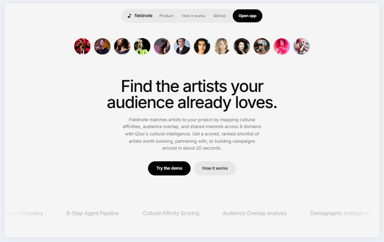
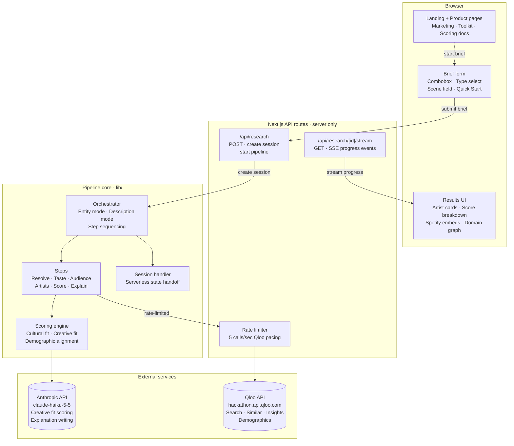
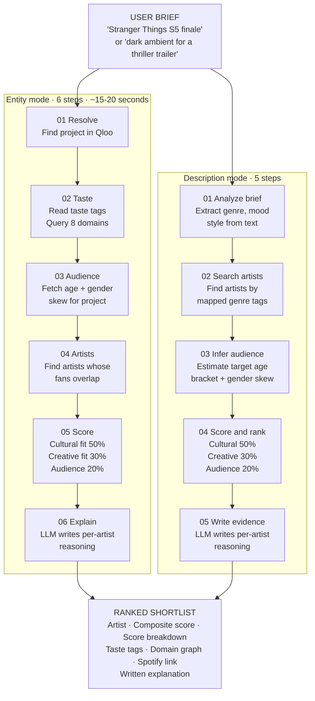
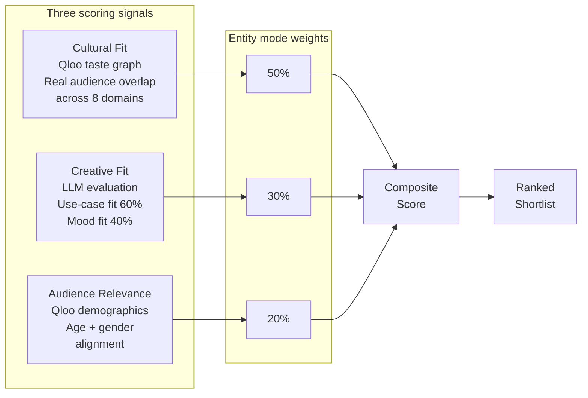
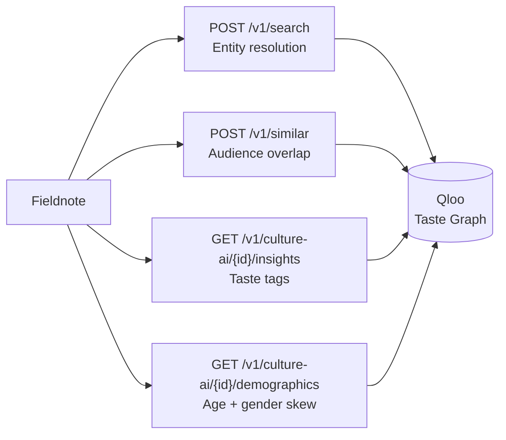

# Fieldnote



Fieldnote is a music sync placement intelligence agent. It finds artists whose audiences genuinely overlap with a project's viewers, not just artists who sound similar. Describe a scene for a TV show, film, ad campaign or video game, and Fieldnote returns a ranked shortlist of artists, each scored and explained, with Spotify links, in about fifteen seconds.

**Live app:** [fieldnote-dusky.vercel.app](https://fieldnote-dusky.vercel.app)
**Repository:** [github.com/Shanks-btc/fieldnote](https://github.com/Shanks-btc/fieldnote)

## Contents

- [The problem](#the-problem)
- [What Fieldnote does](#what-fieldnote-does)
- [How it works](#how-it-works)
- [Architecture](#architecture)
- [The pipeline](#the-pipeline)
- [Scoring](#scoring)
- [What the model does, and what it never does](#what-the-model-does-and-what-it-never-does)
- [What the Qloo API provides](#what-the-qloo-api-provides)
- [Current status](#current-status)
- [Quick start](#quick-start)
- [Environment variables](#environment-variables)
- [Repository layout](#repository-layout)
- [License](#license)

## The problem

Music supervisors place songs in TV shows, films, trailers and ad campaigns. The usual workflow is part Rolodex, part Spotify rabbit-hole, part gut feel. A supervisor knows what vibe they want, but finding an artist who fits the tone *and* whose fanbase actually overlaps with the project's audience means cross-referencing data that lives in different places, or trusting instinct where data would be better.

Genre search doesn't solve this. Two artists can be tagged "indie folk" and share almost no audience. What matters is cultural proximity: do the people who watch this show also listen to this artist? That signal lives in Qloo's taste graph, which maps real-world consumption patterns across entertainment, brands and culture, and it is exactly what Fieldnote is built on.

## What Fieldnote does

Fieldnote makes one thing: a ranked shortlist of artists for a sync placement, where every recommendation is backed by a cultural affinity score from Qloo's taste graph, an LLM-scored creative fit against your brief, and a demographic alignment check.

| Principle | What it means |
|-----------|---------------|
| Cultural overlap, not genre tags | Qloo's taste graph measures how strongly an artist's real fans overlap with the project's real audience across 8 domains |
| Every score is transparent | Expand any result to see the taste tags, domain connections, score breakdown and the model's written reasoning |
| Two entry points, same pipeline | Name a project ("Stranger Things") or describe a scene ("dark ambient for a thriller trailer"), both run the same real scoring |
| Nothing is hidden | If a domain returns no data, the UI says so. If an artist scores low, the reasoning explains why |

## How it works

A user submits a brief one of two ways: by naming a known project (entity mode) or by describing a scene in plain language (description mode). Both paths produce a ranked shortlist through the same scoring logic.

### System architecture



### Pipeline flow



### Scoring pipeline



## Architecture

| Layer | Responsibility | Location |
|-------|---------------|----------|
| Brief form | Project search via combobox, type selection, scene input, quick-start cards with auto-submit | `app/brief/page.tsx`, `components/brief/` |
| Orchestrator | Runs the multi-step pipeline, manages state transitions, streams progress events to the client | `lib/agent/orchestrator.ts` |
| Qloo client | All Qloo API calls: entity search, similar entities, taste insights, demographic profiles | `lib/qloo/` |
| Scoring | Composite score calculation, creative fit LLM calls, demographic alignment math | `lib/agent/steps.ts` |
| Results UI | Artist cards with expandable detail, score breakdowns, taste tag chips, domain badges, Spotify embeds | `components/results/` |
| API routes | Server-side streaming endpoint, session creation and handoff for Vercel's serverless | `app/api/research/` |
| Landing + Product | Marketing pages, toolkit feature cards, scoring explainer, pipeline walkthrough | `app/page.tsx`, `app/product/page.tsx`, `components/landing/` |

### Core components

| Component | What it does | Where |
|-----------|-------------|-------|
| Entity resolver | Searches Qloo for a named project, returns the entity ID and metadata | `lib/qloo/insights.ts` |
| Taste reader | Reads taste tags (descriptors like "Emotive", "Lo-Fi", "Nostalgic") from Qloo's taste graph for any entity | `lib/qloo/insights.ts` |
| Domain scanner | Queries all 8 Qloo domains (Music, TV, Film, Podcasts, Books, Games, Brands, People) for cross-domain connections | `lib/agent/steps.ts` |
| Demographic fetcher | Reads age bracket and gender skew from Qloo for both the reference project and each artist candidate | `lib/qloo/insights.ts` |
| Creative fit scorer | LLM scores each artist against the brief on use-case fit (60%) and mood fit (40%), with per-project-type guidance from `PROJECT_TYPE_CONTEXT` | `lib/agent/steps.ts` |
| Composite ranker | Combines cultural fit (50%), creative fit (30%) and audience relevance (20%) into one weighted score and sorts | `lib/agent/steps.ts` |
| Explanation writer | LLM writes a specific reasoning chain per artist covering tone match, genre alignment, placement potential and risk factors | `lib/agent/steps.ts` |
| Session handler | Manages pipeline state across Vercel's serverless function instances, handles reconnection | `lib/agent/launch.ts` |

## The pipeline

Each step runs automatically. The user watches a real-time progress indicator as each one completes.

### Entity mode (6 steps, ~15-20 seconds)

| Step | Name | What it does | Qloo calls |
|------|------|-------------|------------|
| 01 | Resolve | Finds the named project in Qloo's entity database, returns entity ID | `POST /v1/search` |
| 02 | Taste | Reads the project's taste tags and queries all 8 cultural domains for cross-domain connections | `GET /v1/culture-ai/{id}/insights`, `POST /v1/similar` x8 |
| 03 | Audience | Fetches age bracket and gender demographic skew for the reference project | `GET /v1/culture-ai/{id}/demographics` |
| 04 | Artists | Finds music artists whose real audiences overlap with the project's audience | `POST /v1/similar` (music domain, seeded by project entity) |
| 05 | Score | Scores every candidate on cultural fit, creative fit and demographic alignment using the composite formula | `GET /v1/culture-ai/{id}/demographics` per artist |
| 06 | Explain | LLM writes a specific, structured explanation for every artist's score and ranking | Anthropic API |

### Description mode (5 steps)

When the brief is a scene description rather than a named project, Fieldnote cannot resolve an entity in Qloo's database. Instead it extracts genre and mood tags from the text, maps them to Qloo taste descriptors, finds artists through those tags, infers the target audience demographic from the description and project type, and scores them using the same three-signal composite as entity mode.

| Step | Name | What it does | API calls |
|------|------|-------------|-----------|
| 01 | Analyze brief | LLM extracts genre, mood and style tags from the scene description | Anthropic API |
| 02 | Search artists | Maps extracted tags to Qloo taste descriptors and finds matching artists | `POST /v1/similar` |
| 03 | Infer target audience | LLM infers target age bracket (using Qloo's 6 brackets) and gender skew from the description and project type | Anthropic API |
| 04 | Score and rank | Cultural fit via Qloo popularity + LLM creative fit + inferred demographic alignment (50/30/20) | Qloo API + Anthropic API |
| 05 | Write evidence | LLM writes per-artist reasoning against the scene description | Anthropic API |

## Scoring

Every recommendation carries a composite score built from up to three signals, each sourced and verified independently.

### Entity mode weights

| Signal | Weight | Source | What it measures |
|--------|--------|--------|-----------------|
| Cultural Fit | 50% | Qloo taste graph | How strongly an artist's real fans overlap with the project's audience, measured across 8 cultural domains |
| Creative Fit | 30% | LLM (claude-haiku-5-5) | How well an artist's sound, mood and style match the brief's tone and placement context |
| Audience Relevance | 20% | Qloo demographics | How closely the artist's age and gender profile aligns with the project's audience |

### Description mode weights

In description mode, there is no reference project entity in Qloo, so demographics cannot be pulled from Qloo directly. Instead, the LLM infers the target demographic from the scene description and project type (a thriller trailer skews 18-34, slightly male; a cooking documentary skews 35-54, balanced). This inferred profile uses Qloo's own 6 age brackets so the comparison matches what Qloo returns for each artist. The results page labels this as "Inferred target audience" with the model's reasoning, so users know it is estimated, not measured. If inference fails, audience scoring is skipped with a warning rather than fabricating a balanced fallback.

| Signal | Weight | Source | What it measures |
|--------|--------|--------|-----------------|
| Cultural Fit | 50% | Qloo popularity score | The artist's prominence within Qloo's taste graph for the matched genre and mood tags |
| Creative Fit | 30% | LLM (claude-haiku-5-5) | Same creative scoring as entity mode, evaluated against the scene description |
| Audience Relevance | 20% | LLM-inferred demographics | Age and gender alignment against the inferred target audience for the described scene and project type |

### Creative fit breakdown

The LLM scores each artist on two dimensions with structured evaluation criteria:

| Dimension | Weight | What it evaluates |
|-----------|--------|------------------|
| Use-case fit | 60% | How well the artist's catalog fits the specific placement type (TV scene, film trailer, ad campaign, video game, documentary, podcast, music video) |
| Mood fit | 40% | How well the artist's sound matches the mood and tone described in the brief |

Project type reshapes the scoring guidance. These per-type adjustments are defined in `PROJECT_TYPE_CONTEXT` and fed to the LLM as structured scoring criteria:

| Project type | Scoring emphasis |
|-------------|-----------------|
| TV series | Episode pacing, scene-level tone, binge-watch audience retention |
| Film | Cinematic weight, narrative arc support, theatrical audience |
| Advertising | Brand safety, memorability, broad demographic appeal |
| Trailer | Impact, dynamics, tension-and-release pacing |
| Documentary | Authenticity, emotional subtlety, subject-matter sensitivity |
| Video game | Loopability, adaptive energy, immersion without distraction |
| Podcast | Conversational complement, intro/outro energy, listener demographic |
| Music video | Visual-sonic synergy, genre alignment, artist crossover potential |

## What the model does, and what it never does

| The model does | The model never does |
|----------------|---------------------|
| Scores creative fit against the brief using structured criteria | Invents an affinity score or demographic figure |
| Writes a specific explanation for why each artist fits or doesn't fit | Claims a domain connection that Qloo didn't return |
| Extracts genre and mood tags from a scene description | Replaces Qloo's taste graph with its own associations |
| Adapts scoring guidance based on project type | Decides the final ranking (that is the composite formula) |
| Evaluates use-case fit and mood fit as separate dimensions | Generates artist names or Spotify links (those come from Qloo) |

The LLM is used for two things: scoring creative fit (a structured evaluation with explicit dimensions, not a vibe check) and writing explanations. Everything else, cultural affinity, demographics, taste tags, domain connections, artist discovery, comes from Qloo's API. If Qloo returns no data for a domain, the UI shows that domain as empty rather than filling it with the model's guesses.

## What the Qloo API provides

Fieldnote's recommendations depend on Qloo. Without Qloo, there is no cultural affinity signal, no taste graph, no cross-domain connections and no demographic data. The app would not work the same without it.



| Qloo endpoint | What Fieldnote uses it for |
|---------------|---------------------------|
| `POST /v1/search` | Entity resolution: finding a named project (TV show, film, game) in Qloo's database |
| `POST /v1/similar` | Finding entities with overlapping audiences across all 8 domains, and finding music artists whose fans overlap with the project's audience |
| `GET /v1/culture-ai/{id}/insights` | Reading taste tags (descriptors like "Emotive", "Cinematic", "Lo-Fi") for a project or artist |
| `GET /v1/culture-ai/{id}/demographics` | Reading age bracket and gender audience skew for scoring demographic alignment |

All calls go through `hackathon.api.qloo.com` with the API key in the `X-Api-Key` header, server-side only. Rate limit is 5 calls per second.

### The 8 domains

Every entity-mode run queries all 8 Qloo cultural domains to build a cross-domain taste graph. This graph is displayed to the user alongside the results, showing what the project's audience likes beyond music:

**Music** · **TV** · **Film** · **Podcasts** · **Books** · **Games** · **Brands** · **People**

## Current status

| Surface | Status | Detail |
|---------|--------|--------|
| Entity mode pipeline | Live | Full 6-step pipeline against real Qloo API, real LLM scoring, ~15-20 seconds |
| Description mode pipeline | Live | 5-step pipeline for scene descriptions, real Qloo + LLM scoring + inferred demographics |
| Brief form | Live | Combobox search with 20 popular projects, project type selector, collapsible scene field, quick-start cards with auto-submit |
| Results page | Live | Artist cards with expandable detail, score breakdowns, taste tag chips, domain graph with 8 badges, Spotify embeds |
| Sharing | Live | Shareable results via lz-string URL compression, one-click copy |
| Brief history | Live | localStorage-based history, max 20 entries, clear and resubmit |
| Landing page | Live | Product marketing with toolkit feature cards, scoring explainer, pipeline walkthrough |
| Product page | Live | Detailed scoring methodology, pipeline step-by-step, architecture overview |

## Quick start

### Requirements

- Node.js 18+
- pnpm (recommended) or npm
- API keys: Qloo (hackathon key) and Anthropic

### Install and run

```bash
# Clone the repository
git clone https://github.com/Shanks-btc/fieldnote.git
cd fieldnote

# Install dependencies
pnpm install

# Set up environment variables
cp .env.example .env.local
# Edit .env.local and add your API keys (see Environment variables below)

# Start the development server
pnpm dev
```

Open [http://localhost:3000](http://localhost:3000).

### Build for production

```bash
pnpm build
pnpm start
```

### Deploy to Vercel

```bash
# Install Vercel CLI if needed
npm i -g vercel

# Deploy
vercel
```

Set `QLOO_API_KEY` and `ANTHROPIC_API_KEY` in your Vercel project's environment variables.

## Environment variables

| Variable | Required | Description |
|----------|----------|-------------|
| `QLOO_API_KEY` | Yes | Qloo hackathon API key. Server-side only, never exposed to the browser. |
| `ANTHROPIC_API_KEY` | Yes | Anthropic API key for creative fit scoring and explanation generation. Server-side only. |

Both keys are accessed only in server-side API routes (`app/api/`). They are never bundled into or exposed to the client-side code.

## Repository layout

```
fieldnote/
├── app/
│   ├── page.tsx                    # Landing page
│   ├── product/
│   │   └── page.tsx                # Product page (scoring, pipeline docs)
│   ├── brief/
│   │   └── page.tsx                # Brief form page
│   └── api/
│       └── research/
│           ├── route.ts            # POST: create research session
│           └── [id]/
│               └── stream/
│                   └── route.ts    # GET: SSE stream for pipeline progress
├── components/
│   ├── brief/                      # Brief form components
│   │   ├── project-combobox.tsx    # Searchable project selector
│   │   ├── type-select.tsx         # Project type dropdown
│   │   └── scene-field.tsx         # Collapsible scene description input
│   ├── results/                    # Results page components
│   │   ├── artist-card.tsx         # Individual artist result card
│   │   ├── score-breakdown.tsx     # Expandable score detail
│   │   ├── taste-tags.tsx          # Taste tag chip display
│   │   ├── domain-badges.tsx       # 8-domain query status badges
│   │   └── spotify-embed.tsx       # Inline Spotify player
│   ├── landing/                    # Landing page sections
│   │   ├── hero.tsx                # Hero section with CTA
│   │   ├── toolkit.tsx             # Feature cards grid
│   │   ├── scoring.tsx             # Scoring methodology section
│   │   └── pipeline.tsx            # Pipeline walkthrough section
│   └── ui/                         # shadcn/ui base components
├── lib/
│   ├── agent/
│   │   ├── orchestrator.ts         # Pipeline orchestration (entity + description mode)
│   │   ├── steps.ts                # All pipeline steps, scoring logic, domain config
│   │   ├── types.ts                # Shared TypeScript types for pipeline and scoring
│   │   └── launch.ts               # Session handoff for serverless
│   ├── llm/
│   │   └── audience.ts             # LLM demographic inference for description mode
│   └── qloo/
│       └── insights.ts             # Qloo API client (search, similar, insights, demographics)
├── hooks/                          # React hooks
├── styles/                         # Global styles (Tailwind v4)
├── scripts/                        # Utility scripts
├── docs/                           # Documentation and assets
├── .env.example                    # Environment variable template
├── LICENSE                         # MIT License
├── package.json
├── tailwind.config.ts
└── tsconfig.json
```

---

**Tech stack:** Next.js 16 (App Router) · TypeScript · Tailwind CSS v4 · shadcn/ui · Qloo API · Anthropic API


## License

This project is licensed under the MIT License. See the [LICENSE](./LICENSE) file for details.